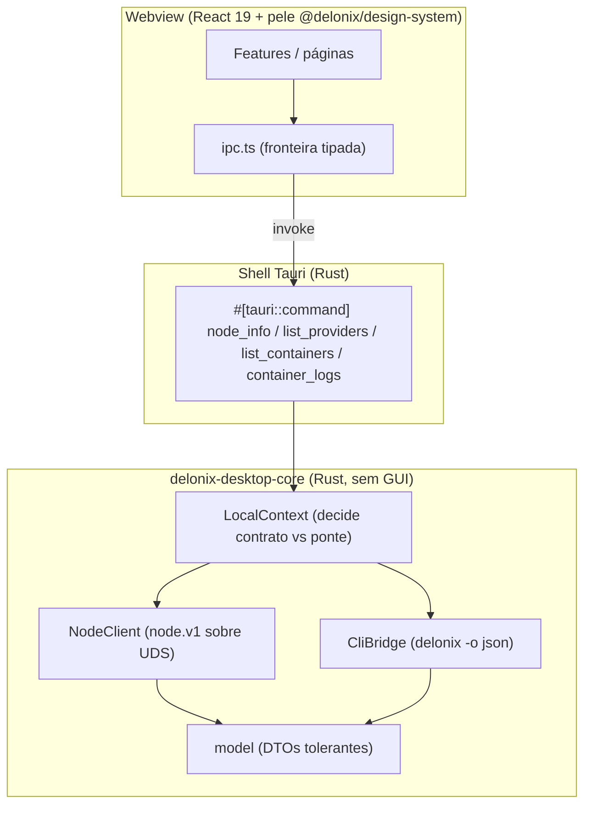
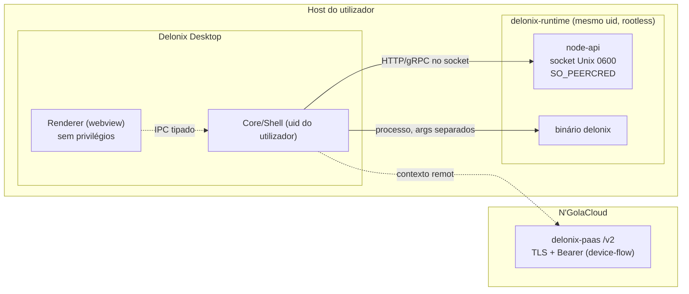
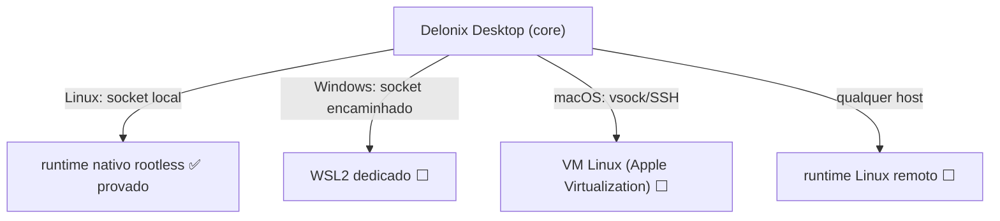

# Arquitectura do Delonix Desktop

> Fase 0. Decisões validadas pela prova técnica de 2026-10-24
> (`reports/`). Shell **Tauri**; novo repo + pele partilhada (ADR-0001);
> contratos & contextos (ADR-0002).

## 1. Princípio

O desktop é um **cliente**. Não executa workloads, não reimplementa o motor, não
contorna autorização de tenants. Toda a lógica cliente↔runtime vive numa
**camada-core em Rust** (`crates/delonix-desktop-core`), independente da GUI, que
o shell Tauri expõe ao webview por uma **fronteira IPC tipada única**. A UI nunca
toca em sockets nem executa processos.

## 2. Camadas (Clean Architecture)



Regras de dependência: o webview depende do shell; o shell depende do core; o
core não depende de nenhum dos outros. A pele (`@delonix/design-system`) é
transversal e não conhece backend.

## 3. Fronteiras de confiança



- **Renderer ↔ Core**: única via é o IPC. CSP estrita (`tauri.conf.json`):
  `default-src 'self'`, sem `connect-src` para a rede aberta.
- **Core ↔ runtime (LOCAL)**: socket Unix `0600` filtrado por `SO_PEERCRED` — só
  o uid chamador. Loopback/local não é autorização por si; o filtro do servidor
  é. A ponte CLI passa argumentos **separados**, nunca uma linha de shell.
- **Core ↔ cloud (REMOTO)**: TLS + Bearer; tenant derivado do token, nunca do
  cliente.

## 4. Os dois contextos

| | LOCAL | REMOTO |
|---|---|---|
| Backend | delonix-runtime | delonix-paas |
| Transporte | socket Unix (`node.v1`) + CLI | HTTPS `/v2` |
| Auth | `SO_PEERCRED` (uid) | device-flow RFC 8628, Bearer |
| Identidade | recursos locais | tenant (do token), ids `vm_`/`app_` |
| Estado nesta fase | ✅ provado | ⬜ esboço (Fase 4) |

`LocalContext` existe hoje; `RemoteContext` é o tipo-irmão da Fase 4, com a mesma
forma de DTOs onde possível.

## 5. Runtime machines por plataforma

O **socket do node-api é o contrato host↔guest universal**. Muda só como se lá
chega:



- **Linux**: runtime nativo, rootless. Provado ao vivo neste host (Zorin 18).
- **Windows**: distribuição WSL2 **dedicada** gerida pelo Delonix (preserva as do
  utilizador); o socket do node-api é encaminhado para o host. Fase 1 (cont.).
- **macOS**: VM Linux via Apple Virtualization; node-api sobre vsock/SSH. Nunca
  assumir `/dev/kvm` nem reutilizar Cloud Hypervisor como backend nativo macOS.

## 6. Limitação de ambiente conhecida (honesta)

A **janela Tauri não compila** em hosts sem as libs do webview. Em Ubuntu/Zorin
«noble» instala-se com (acção `sudo` do dono, **não** executada pelo agente):

```bash
sudo apt install libwebkit2gtk-4.1-dev build-essential curl wget file \
  libxdo-dev libssl-dev libayatana-appindicator3-dev librsvg2-dev
```

A arquitectura foi provada **sem** a janela: a camada-core é exercitada pelo
binário `delonix-desktop-proof`, e o frontend compila/empacota com `vite build`
(o webview só é preciso em runtime). Ver `reports/`.

## 7. Matriz de versões (a manter)

| Componente | Versão provada | Nota |
|---|---|---|
| delonix engine / node-api | 5.1.1 | contrato `delonix.node.v1`, catálogo caps 1.4.0 |
| Node / npm | 25.0.0 / 11.6.2 | frontend |
| Rust | 1.96.0 | core + (futuro) shell |
| Tauri | 2.x | shell (build bloqueado neste host) |
